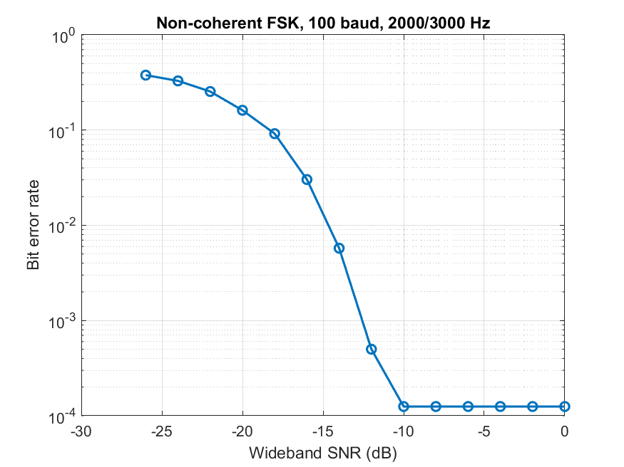

# Acoustic FSK Calculator (MATLAB)

Two computers talk to each other **through sound**. Computer A sends a calculation
(e.g. `12+34`) as audio tones, Computer B decodes it, computes the sum, and sends
the answer back the same way. Computer A displays the result.

> Originally a university project for *Analog and Digital Communication*,
> rebuilt from scratch and extended with a noise analysis and a single-machine simulation.

## Demo
<!-- Add GIF or video link here -->

## System design
`A: text -> bits -> FSK modulator -> speaker  ~~air~~>  mic -> sync -> FSK demodulator -> B: compute sum -> (same chain back to A)`

## Design choices
- **Modulation:** non-coherent binary FSK, 2000 Hz = bit 0, 3000 Hz = bit 1, 100 baud.
  Each symbol holds a whole number of cycles, so the tones are orthogonal.
- **Detector:** per-symbol energy comparison at both tones (phase-independent).
- **Synchronisation:** 0.15 s linear chirp preamble found by matched filtering.
- **Framing:** 8-bit length header, then 8 bits per ASCII character.

## Results

- Error-free down to about -12 dB wideband SNR in simulation; BER rises to <!-- ~39% --> near -26 dB.
- Live test: <!-- distance, room, volume, success rate -->
- Data rate: 100 bit/s.

## How to run
Requires MATLAB (tested on R2022b, base MATLAB only; `spectrogram` plot needs Signal Processing Toolbox).
- **Single machine:** `run_simulation`, then `ber_vs_snr`.
- **Two laptops:** run `computer_B`, wait for "listening", then run `computer_A` on the other.

## Limitations and future work
- No error correction (e.g. Hamming or repetition codes would extend range).
- Half-duplex with fixed timing windows.
- Higher data rates would need more tones (M-FSK) and echo handling.
